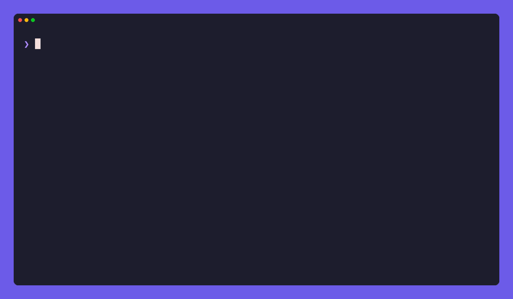

# svm

Creates and runs Linux virtual machines for AI agents, on macOS and Linux, on arm64 and x86-64. No daemon: each running machine is a process of its own.



It lives alongside the SwiftVM app and its `swiftvm` command: its own command, folders (`~/Library/Application Support/svm`, `~/Library/Caches/svm`, or `~/.local/share/svm` and `~/.cache/svm` on Linux) and variables (`SVM_HOME`, `SVM_CACHE`, `SVM_RUNTIME`). An app that ships `svm` inside it sets those three to folders of its own, so it never meets an installed `svm`: see [docs/api.md](docs/api.md#shipping-the-program-in-an-app).

## Install

```sh
curl -fsSL https://github.com/swiftvm-app/cli/releases/latest/download/install.sh | sh
```

It installs into `~/.local/bin`; `SVM_INSTALL_DIR` picks another folder and `SVM_VERSION` another release. Or with Homebrew:

```sh
brew install swiftvm-app/tap/svm
```

macOS 14 or later, or Linux with KVM (the user in the `kvm` group). The Mac programs are signed with a Developer ID and notarized.

## Install from source

```sh
scripts/install.sh            # into ~/.local/bin
scripts/install.sh ~/bin      # or into another folder
```

| System | Needs | Gets |
|---|---|---|
| macOS 14 or later | Rust, and the Linux musl target for this processor (`rustup target add aarch64-unknown-linux-musl`), which the guest agent is built for | The program, signed with the virtualization entitlement |
| Linux with KVM | Rust with the musl target for this processor, `musl-tools`, a C compiler and `curl`. The user must be in the `kvm` group | A static program, with `passt` next to it |

Installing again while machines run is safe: they keep the program they started with. To uninstall, delete the program (and `passt` on Linux) from the folder.

## Use

```sh
svm create debian-13 --name dev
svm start dev
svm wait dev
svm ssh dev
svm help
```

Apps use `--json`, described in [docs/api.md](docs/api.md).

## Release

Run the Release workflow from the Actions tab, or:

```sh
gh workflow run release.yml -f version=patch    # or minor, major, or a version such as 1.2.0 or 1.2.0-beta.1
```

[.github/workflows/release.yml](.github/workflows/release.yml) sets the version in `Cargo.toml` ([scripts/set-version.sh](scripts/set-version.sh)), commits it to `main` and tags it. It then builds for macOS and Linux on arm64 and x86-64, signs and notarizes the Mac programs, publishes the release with `install.sh` and `SHA256SUMS`, and updates `Formula/svm.rb` in [swiftvm-app/homebrew-tap](https://github.com/swiftvm-app/homebrew-tap). A version with a hyphen is a pre-release, which leaves the latest release and the tap alone. A version that `Cargo.toml` already has is only tagged, as for the first release, 0.1.0.
